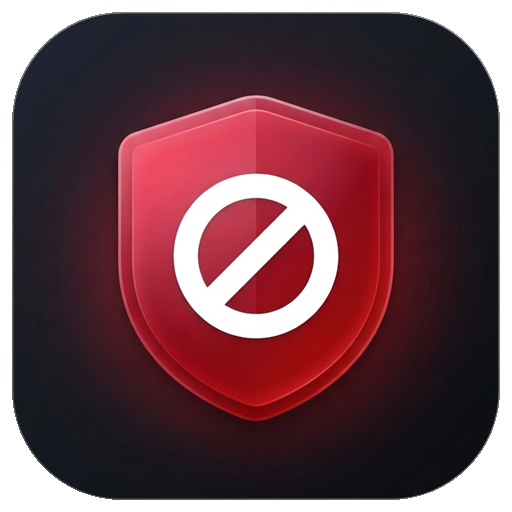

<div align="center">



# Adobe Tools

拦截 Adobe 联网和正版校验弹窗的小工具，支持 Windows 和 macOS。

[](https://github.com/Rita6333/Adobe-Tools)
[](https://github.com/Rita6333/Adobe-Tools/releases)
[](#使用方式)
[](#使用方式)

</div>

<p align="center">
  
  
</p>

## 下载

直接去 [Releases](https://github.com/Rita6333/Adobe-Tools/releases) 下对应系统的安装包就行：

- Windows：`Adobe.Tools.exe`（单文件，不用安装，双击直接用）
- macOS：`Adobe-Tools-macOS-Universal.dmg` 或 `.pkg`（支持 Apple Silicon 和 Intel）

## 使用方式

1. 打开 `Adobe Tools`，按系统提示给管理员权限（改防火墙和 hosts 必须用管理员权限）。
2. 在首页点 **开启三层断网拦截**。如果某个 Adobe 软件正在运行，重启一下那个软件就会生效。
3. 如果 Adobe 装在非默认路径（比如 D 盘或其他自定义目录），直接把文件夹拖进窗口，或者点 **+ 自定义目录** 选一下再应用。
4. 想恢复原状随时点 **还原全部改动**，所有改动都会按修改前的记录还原。

## 具体改了系统哪些地方

工具只动下面三处，每次修改前都会记录原始状态，还原时不会碰你的其他配置：

1. **防火墙规则**
   - Windows：自动扫描常见安装目录以及注册表里的 Adobe 卸载项，给每个 `.exe` 加出站阻止规则，统一归在 `Zaka Adobe Block` 组下（可选勾选同时加「含入站规则」）。
   - macOS：扫描 `/Applications` 及用户应用目录下的 Adobe `.app`，通过系统 `socketfilterfw` 拦截。
2. **hosts 屏蔽**
   - 在系统 hosts 末尾追加一段带起止标记的区块，把 41 个激活、Genuine 正版校验、更新和遥测域名同时指向 `0.0.0.0` 和 `::1`，并刷新 DNS 缓存。
   - 第一次改动前会先备份原始 hosts。想自己补域名的话，在软件里的「域名」页或者直接编辑同目录的 `adobe-domains.txt`（一行一个，`#` 开头算注释），保存后重新应用就行。
3. **后台校验服务和启动项**
   - Windows：停止并禁用 `AGSService`、`AGMService`、`AdobeARMservice` 等后台服务，以及名称或路径含 Adobe 的计划任务。原来的启动方式会记在 `state.json` 里，还原时照原样改回去。
   - macOS：卸载并禁用 `/Library/LaunchAgents`、`/Library/LaunchDaemons` 和 `~/Library/LaunchAgents` 下的 `com.adobe.*.plist`，同时结束后台常驻进程。

不想动 hosts 或服务的话，在首页对应卡片右上角把开关关掉即可。

## 代理防侧漏（Mihomo / Clash）

平时开了代理工具的 **TUN 模式**、**Fake-IP** 或 **系统代理** 时，部分流量会直接从代理内核走，可能绕过系统 `hosts` 和本机进程防火墙造成侧漏。

软件的 **「域名 → Mihomo / Clash 防侧漏规则集」** 里可以直接生成并导出包含本机扫描到的全部 Adobe `.exe` 进程名的规则文件；如果你在配置里直接订阅仓库规则集，把下面这段加到 Mihomo 配置最前面就行：

```yaml
dns:
  use-system-hosts: true

rule-providers:
  adobe-block:
    type: http
    behavior: classical
    format: yaml
    url: "https://raw.githubusercontent.com/Rita6333/Adobe-Tools/main/rules/mihomo/adobe-block.yaml"
    path: ./ruleset/adobe-block.yaml
    interval: 86400

rules:
  - RULE-SET,adobe-block,REJECT-DROP
```

仓库 `rules/mihomo/` 下同时提供了 `adobe-block.yaml`（`classical` 含域名与进程名）、`adobe-domain.yaml`（`domain` 格式）和 `adobe-block.list`（纯文本格式），按需引用即可。

## 自动更新

软件打开后会默认检查 GitHub Releases 上有没有新版本（可以在更新窗口里关掉自动检查，或者跳过某个版本）。

更新前会核对文件完整性和 `SHA256SUMS.txt`：Windows 端校验完会直接替换当前 `.exe` 并自动重启，macOS 端会把安装包下到 `~/Downloads` 并打开。

## 命令行用法（Windows）

`Adobe Tools.exe` 带参数运行会走命令行模式，不弹窗口：

```powershell
# 应用 / 查看状态 / 还原
& '.\Adobe Tools.exe' apply
& '.\Adobe Tools.exe' status
& '.\Adobe Tools.exe' revert

# 带上自定义目录启动界面
& '.\Adobe Tools.exe' "D:\Adobe"

# 检查更新 / 直接更新
& '.\Adobe Tools.exe' check-update
& '.\Adobe Tools.exe' update

# 导出 Mihomo 防侧漏规则集（含本机扫描到的 Adobe 进程名）
& '.\Adobe Tools.exe' export-mihomo

# 跑内置的 19 项逻辑自检（hosts 解析幂等性 + 自动更新 + Mihomo 规则）
& '.\Adobe Tools.exe' selftest
```

## 自己编译

Windows 需要 VS 2022（Build Tools / Community / Enterprise 都可以）和 Windows 10/11 SDK，在根目录跑：

```powershell
powershell -ExecutionPolicy Bypass -File .\build.ps1
```

macOS 需要 Xcode Command Line Tools，在根目录跑：

```bash
chmod +x macos/build-macos.sh
./macos/build-macos.sh
```

打包结果会生成在 `dist/macos/` 下（包含 `.app`、`.dmg` 和 `.pkg`）。打 `v*` 标签推送到 GitHub 也会自动走 `.github/workflows/release.yml` 编译双端并发布 Release。

## 目录结构

```text
.
├── Adobe Tools.exe              Windows 单文件主程序
├── adobe-domains.txt            自定义追加屏蔽域名
├── build.ps1                    Windows 编译脚本
├── src/
│   ├── main.cpp                 Windows C++17 主程序（Win32 + WebView2）
│   ├── ui.html                  Windows / macOS 共用的前端页面
│   ├── resource.rc              图标、版本信息与内嵌页面资源
│   ├── app.manifest             UAC 提权与高 DPI 清单
│   └── webview2/                WebView2 头文件和静态库
├── macos/
│   ├── main.mm                  macOS Objective-C++ 主程序（Cocoa + WKWebView）
│   └── build-macos.sh           macOS 打包脚本
├── docs/                        图标和界面截图
├── rules/mihomo/                Mihomo / Clash 防侧漏订阅规则集
└── .github/workflows/
    └── release.yml              打 tag 自动构建并发布 Release
```

## 本地备份和配置文件位置

- Windows：`C:\ProgramData\ZakaAdobeNetworkBlock\`（包含 `hosts.original`、`state.json`、`update-config.json` 和 WebView2 缓存，可在软件底栏点「状态目录」直接打开）
- macOS：`/usr/local/var/zaka-adobe-block/` 与 `~/Library/Application Support/AdobeTools/`

## 常见问题

- **Adobe 更新完又开始弹窗**：新版本可能多了新的 `.exe` 或改了目录名，打开软件再点一次「重新应用拦截」就行，重复点不会叠加重复规则。
- **提示防火墙服务未运行 / hosts 写不进去**：通常是 360、火绒这类安全软件接管了系统防火墙，或者把 hosts 锁成只读了。临时放行一下再试，或者在首页关掉 hosts 开关只用防火墙和服务拦截。
- **第一次打开 Windows 报 SmartScreen 警告**：个人工具没有买商业代码签名证书，点「更多信息 → 仍要运行」即可。
- **云文档、Adobe Fonts、Stock 打不开**：断网后的正常现象，不影响 PS / PR / AE / AI / Acrobat 等本地功能。
- **微软商店版 Adobe 扫不到**：商店版装在系统受保护的 `WindowsApps` 目录里，常规安装包和 Creative Cloud 安装的版本不受影响。
