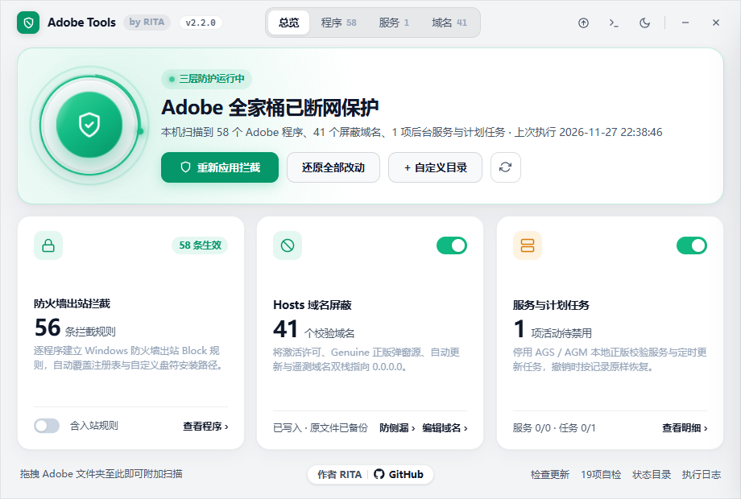
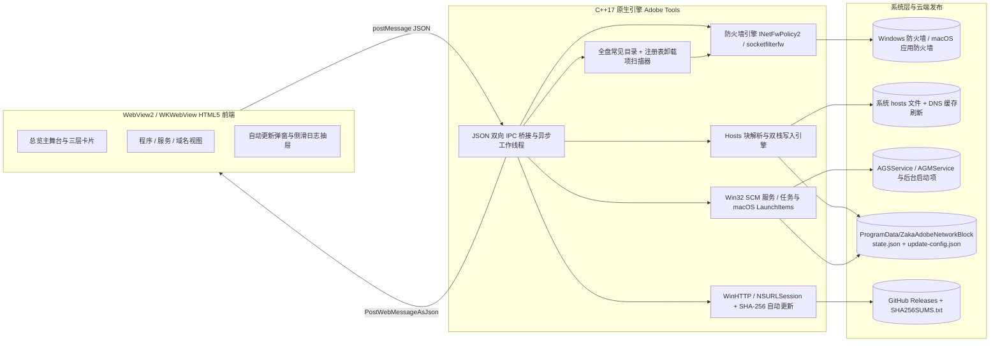

<div align="center">


# Adobe Tools

Windows 与 macOS 平台的 Adobe 全家桶三层断网拦截工具桌面端，支持一键自动更新。

[](https://github.com/Rita6333/Adobe-Tools)
[](#从源码构建)
[](#界面与功能)
[](#快速开始)
[](#macos-原生编译与安装包打包app--dmg--pkg)
[](#排查与内置自检)

**[快速开始](#快速开始)** | **[自动更新](#自动更新机制)** | **[架构与原理](#架构与三层拦截原理)** | **[界面与功能](#界面与功能)** | **[命令行用法](#命令行用法)** | **[仓库结构](#仓库结构)** | **[从源码构建](#从源码构建)** | **[排查与自检](#排查与内置自检)**

</div>

---

<p align="center">
  
  
</p>

## 概述

**Adobe Tools**（作者：**RITA**）面向 Windows 10 / 11（64 位）与 macOS 用户，提供一站式 Adobe 全家桶联网阻断、正版校验弹窗防护与在线自动更新能力。

本工具不依赖外部运行库或第三方框架，通过 **系统防火墙拦截**、**系统 Hosts 双栈屏蔽**、**后台服务与计划任务停用** 三层协同工作，从网络层、域名解析层与本地常驻进程层彻底切断激活验证、Genuine 正版完整性弹窗、自动更新与云端遥测，同时保留完整原始快照，支持随时**一键无损还原**。

项目交付形态高度精简：

- **独立单文件桌面端**：`Adobe Tools.exe` 由 MSVC C++17 编译，静态链接 CRT（`/MT`）与 `WebView2LoaderStatic.lib`，界面 `src/ui.html` 内嵌为 Win32 资源，复制单个 `.exe` 即可在任意 Windows 10 / 11 电脑上直接运行。
- **零外部进程瓶颈**：防火墙规则通过 Windows 原生 COM 接口 `INetFwPolicy2` 批量读写（支持 `netsh` 兜底），后台服务走 Win32 SCM 接口，计划任务走 `ITaskService` COM 接口，数十至上百条规则秒级完成。
- **内置自动更新**：基于原生 WinHTTP / NSURLSession 对接 GitHub Releases，支持启动静默检查、下载进度与网速显示、PE 结构校验 + SHA-256 哈希核验、Windows 原子热替换自动重启与 macOS 安装包自动拉起。
- **双模统一**：双击打开无边框原生圆角图形界面；在终端传入参数时自动切换为命令行静默模式。

---

## 快速开始

### Windows 图形界面（推荐）

1. 从 [GitHub Releases](https://github.com/Rita6333/Adobe-Tools/releases) 下载最新版 **`Adobe Tools.exe`**（或直接运行根目录下的可执行文件）。
2. 在 Windows UAC 管理员权限提示中点击 **「是」**。
3. 在 **总览** 视图中按需确认三张防护层卡片的开关，点击 **「开启三层断网拦截」**（或直接点击左侧盾牌圆环）。
4. 等待主状态变为绿色 **「三层防护运行中」**；已打开的 Adobe 程序重启后立即断网生效。
5. 如需恢复，随时点击 **「还原全部改动」** 即可撤销全部防火墙规则、hosts 屏蔽段与服务/任务状态。

### 交付组件一览

| 组件 | 用途 | 平台 |
| --- | --- | --- |
| `Adobe Tools.exe` | 原生 C++17 + WebView2 HTML5 图形界面（内置 CLI、自动更新与 18 项自检） | Windows 10 / 11 x64 |
| `Adobe-Tools-macOS-Universal.dmg / .pkg` | 原生 Objective-C++17 + WKWebView 通用安装包（Apple Silicon + Intel） | macOS 11+ |
| `adobe-domains.txt` | 附加自定义屏蔽域名清单（可在 GUI 内在线编辑保存） | Windows / macOS |
| `build.ps1` | 一键生成多分辨率图标并调用 MSVC 静态构建 `Adobe Tools.exe` | Windows 构建机 |
| `macos/build-macos.sh` | 一键构建 macOS Universal `.app`、`.dmg` 与 `.pkg` 安装包 | macOS 构建机 |

---

## 自动更新机制

Adobe Tools 内置完整的原生自动更新引擎（无需外部更新器）：

- **启动静默检查**：启动后自动异步检查 `Rita6333/Adobe-Tools` 的最新 GitHub Release（可在更新窗口中随时开关「启动时自动检查更新」或「跳过此版本」），自动遵循系统代理配置。
- **多入口触达**：发现新版本时，顶栏版本号徽章与更新图标亮起翠绿脉冲提示点，同时右上角平滑浮现不挤占主界面的更新提醒条；也可随时点击顶栏版本号、更新图标或底栏 **「检查更新」** 打开更新详情窗。
- **安全完整性校验**：
  - 仅允许从可信 GitHub HTTPS 域名拉取更新包；
  - Windows 端使用系统原生 CNG (`BCrypt`) 与 PE 头校验下载文件，若 Release 附带 `SHA256SUMS.txt` 则强制核验 SHA-256 哈希一致后才允许安装；
  - macOS 端使用 `CommonCrypto` 进行 SHA-256 校验，通过后自动打开下载的 `.dmg` / `.pkg` 安装包。
- **Windows 无损热替换重启**：采用原子重命名（旧程序改名为 `.old`）+ 复制新程序（失败自动秒级回滚）+ 自动拉起新版并清理 `.old` 残留文件，更新完成后自动弹出升级成功提示。
- **CI/CD 自动发布**：向仓库推送 `v*` 标签（例如 `v2.2.0`）后，[release.yml](./.github/workflows/release.yml) 会自动并行编译 Windows `Adobe Tools.exe` 与 macOS Universal `.dmg`/`.pkg`，生成 `SHA256SUMS.txt` 并发布 GitHub Release。

---

## 架构与三层拦截原理



### ① 防火墙：逐程序出站拦截

程序启动或执行拦截时，自动递归扫描以下位置中的所有可执行文件：

- `C:\Program Files\Adobe`、`C:\Program Files\Common Files\Adobe`
- `C:\Program Files (x86)\Adobe`、`C:\Program Files (x86)\Common Files\Adobe`
- `C:\ProgramData\Adobe`
- `%LOCALAPPDATA%\Adobe`、`%LOCALAPPDATA%\Programs\Adobe*`
- `HKLM` / `HKCU` 卸载注册表项中 `DisplayName` 或 `Publisher` 为 Adobe 的全部 `InstallLocation` 与 `DisplayIcon` 目录（自动覆盖 D 盘等自定义安装路径）
- 用户通过 **「+ 自定义目录」** 或**拖放文件夹到窗口**附加的任意路径

每条规则均归入独立分组 `Zaka Adobe Block`（同时兼容清理早期 `ZakaAdobeBlock` 分组）。Windows 防火墙中 **Block 规则优先级严格高于 Allow 规则**，可压制 Adobe 自行创建的放行条目；还原时仅按组删除本工具规则，不触碰系统其他防火墙策略。

### ② Hosts 文件：41 条核心域名双栈屏蔽

在 `C:\Windows\System32\drivers\etc\hosts`（macOS 为 `/etc/hosts`）末尾追加带边界标记的独立区块，对每条域名同时写入 IPv4（`0.0.0.0`）与 IPv6（`::1`）屏蔽记录，并自动刷新系统 DNS 缓存：

| 域名类别 | 条数 | 典型域名 |
| --- | --- | --- |
| 激活与许可证校验 | 27 | `activate.adobe.com`、`practivate.adobe.com`、`uds.licenses.adobe.com`、`lm.licenses.adobe.com`、`3dns*.adobe.com` |
| 正版验证弹窗源头 | 3 | `genuine.adobe.com`、`prod.adobegenuine.com`、`adobegenuine.com` |
| 更新与组件下载 | 6 | `swupmf.adobe.com`、`swupdl.adobe.com`、`armmf.adobe.com`、`armdl.adobe.com`、`cc-cdn.adobe.com` |
| 账号登录与云端遥测 | 5 | `ims-na1.adobelogin.com`、`adobelogin.com`、`cc-api-data.adobe.io`、`ic.adobe.io`、`ccd.storage.adobe.io` |

- 首次修改前自动备份原始 hosts 至 `C:\ProgramData\ZakaAdobeNetworkBlock\hosts.original`（macOS 为 `/usr/local/var/zaka-adobe-block/hosts.original`）。
- 重复执行严格幂等，不会叠加重复区块；还原时完整剥离标记块，原有自定义 hosts 行一字不改。
- 如需追加其他校验域名，可在软件的 **域名** 视图或直接编辑 `adobe-domains.txt`（一行一个，`#` 开头为注释，兼容 `0.0.0.0 domain.com` 格式），保存后重新应用拦截即可。

### ③ 后台服务与计划任务

正版校验弹窗（Adobe Genuine Service）主要由本地常驻服务触发，单纯断网不足以阻止本地弹窗。本层会自动处理：

- **Windows 后台服务与计划任务**：识别 `AGSService`、`AGMService`、`AdobeARMservice`、`AdobeUpdateService` 及可执行路径/显示名称包含 `Adobe` 的服务与计划任务并停用；所有原始 `StartMode` / `State` 均记录于 `state.json`，还原时逐项恢复。
- **macOS LaunchAgents / LaunchDaemons**：禁用 `com.adobe.*.plist`（重命名为 `.zaka-disabled`）并结束常驻校验进程，还原时原样恢复。

---

## 界面与功能

`Adobe Tools` 采用无边框原生圆角设计，支持拖动顶栏移动窗口、双击顶栏最大化、边缘缩放、文件/文件夹直接拖放，以及右上角流畅切换**浅色瓷白**与**深色曜石**主题（偏好自动记忆）。

| 视图 / 入口 | 功能说明 |
| --- | --- |
| **总览** | 顶部防护盾牌主舞台（红/绿律动光环、实时状态、上次执行时间、主按钮与进度条）；下方三张独立防护层卡片，可直接开关「Hosts 域名屏蔽」、「后台服务与计划任务」及「含入站规则」 |
| **程序** | 列出扫描到的全部 Adobe 程序，支持按文件名或路径实时搜索过滤，并可点击 **「定位」** 在资源管理器 / Finder 中选中文件 |
| **服务** | 集中展示本机检测到的所有 Adobe 后台服务与计划任务（macOS 为 LaunchAgents / Daemons）及其当前运行状态、启动模式 |
| **域名** | 左侧按类别展示 41 条内置核心屏蔽域名；右侧提供 `adobe-domains.txt` 在线编辑器，支持一键保存与打开系统 hosts 目录 |
| **自动更新弹窗** | 点击顶栏版本号、更新按钮或底栏 **「检查更新」** 打开，展示版本对比、更新日志、下载进度/速度、SHA-256 校验状态与自动检查开关 |
| **执行日志抽屉** | 点击顶栏终端图标或底栏 **「执行日志 / 18项自检」** 从右侧平滑展开，实时查看每一步审计日志、一键复制或触发内置自检 |

---

## 命令行用法

```powershell
# 启动图形界面（可附带自定义目录参数）
& '.\Adobe Tools.exe'
& '.\Adobe Tools.exe' "D:\Adobe"

# 静默应用三层拦截（需管理员权限）
& '.\Adobe Tools.exe' apply

# 查看当前防火墙、hosts、服务与计划任务状态
& '.\Adobe Tools.exe' status

# 静默还原全部拦截改动（需管理员权限）
& '.\Adobe Tools.exe' revert

# 检查 GitHub Releases 最新版本 / 直接下载校验并更新
& '.\Adobe Tools.exe' check-update
& '.\Adobe Tools.exe' update

# 运行 18 项内置逻辑自检（13 项 Hosts 引擎 + 5 项自动更新引擎）
& '.\Adobe Tools.exe' selftest
```

---

## 仓库结构

```text
.
├── Adobe Tools.exe              Windows 单文件图形界面主程序（C++17 + 静态 WebView2）
├── adobe-domains.txt            自定义追加屏蔽域名配置文件
├── build.ps1                    一键图标生成 + MSVC 静态编译脚本
├── README.md                    项目说明文档
├── .gitignore                   构建临时文件忽略规则
├── .github/workflows/
│   └── release.yml              GitHub Actions 双端构建与自动发布 Release 工作流
├── docs/
│   ├── logo.png                 应用标识图标
│   ├── preview-light.png        浅色瓷白主界面实机截图
│   └── preview-dark.png         深色曜石主界面实机截图
├── src/
│   ├── main.cpp                 C++17 Win32 无边框窗口、WebView2 桥接、三层拦截与自动更新引擎
│   ├── ui.html                  HTML5 / CSS3 / JS 双主题桌面界面（编译时内嵌为资源）
│   ├── resource.rc              图标、版本属性（作者 RITA）与 RCDATA HTML 资源脚本
│   ├── app.manifest             UAC requireAdministrator 与 PerMonitorV2 DPI 感知清单
│   ├── app.ico                  多分辨率程序图标（16 / 32 / 48 / 256 px）
│   └── webview2/                WebView2 头文件与静态加载库（WebView2LoaderStatic.lib）
└── macos/
    ├── main.mm                  macOS 原生 Objective-C++17 + WKWebView 桌面端与自动更新源码
    └── build-macos.sh           macOS Universal .app / .dmg / .pkg 一键构建打包脚本
```

---

## 从源码构建

### Windows 一键编译

环境要求：Windows 10 / 11 (x64)、Visual Studio 2022（BuildTools / Community / Professional / Enterprise 均可）、Windows 10/11 SDK 与 Edge WebView2 Runtime。

```powershell
powershell -ExecutionPolicy Bypass -File .\build.ps1
```

构建脚本会自动生成多分辨率 `src/app.ico`、编译 Win32 资源与内嵌 `src/ui.html`，并调用 MSVC 静态链接输出独立单文件 **`Adobe Tools.exe`**。

### macOS 原生编译与安装包打包（`.app` / `.dmg` / `.pkg`）

仓库包含与 Windows 共享 `src/ui.html` 的 macOS 原生 Objective-C++17 + `WKWebView` 源码（`macos/main.mm`）：

```bash
chmod +x macos/build-macos.sh
./macos/build-macos.sh
```

输出产物位于 `dist/macos/`：
- `Adobe Tools.app`（Apple Silicon `arm64` + Intel `x86_64` 通用二进制）
- `Adobe-Tools-macOS-Universal.dmg`（拖拽安装镜像）
- `Adobe-Tools-macOS-Universal.pkg`（原生系统安装包，安装至 `/Applications/Adobe Tools.app`）

推送 `v*` 标签至 GitHub 后，[release.yml](./.github/workflows/release.yml) 也会在云端自动产出 Windows 与 macOS 全套发布资产及 `SHA256SUMS.txt`。

---

## 状态记录与备份

Windows 端运行时数据统一存放在系统程序数据目录，可在软件底栏点击 **「状态目录」** 直接打开：

```text
C:\ProgramData\ZakaAdobeNetworkBlock\
├── state.json         上次执行时间、拦截程序数、被修改服务与计划任务的原始状态记录
├── update-config.json 自动更新检查开关、已跳过版本与上次检查时间
├── hosts.original     首次写入前的原始系统 hosts 文件完整备份
├── Updates\           更新包临时下载与校验目录（替换完成后自动清理）
└── WebView2Cache\     WebView2 独立浏览器缓存目录
```

---

## 排查与内置自检

### 18 项内置逻辑自检

点击软件右下角 **「18项自检」** 或运行 `& '.\Adobe Tools.exe' selftest`，可执行全链路逻辑验证，覆盖：

- **13 项 Hosts 引擎校验**：空操作保留、41 条核心域名写入、重复写入幂等、完整剥离还原、行尾无换行块粘连清理、块外自定义行保留、残缺块清理；
- **5 项自动更新引擎校验**：SemVer 语义化版本比较、GitHub Release JSON 与 Unicode 转义解码、平台资产智能匹配、`SHA256SUMS.txt` 空格/点号文件名映射解析、CNG / CommonCrypto SHA-256 哈希向量验证。

### 常见问题

| 现象 | 原因与处理方式 |
| --- | --- |
| **检查更新提示「仓库尚未发布正式 Release」或连接超时** | 仓库刚创建尚未打 `v*` Tag 发布 Release 时属于正常提示；若网络无法直连 GitHub，开启系统代理后重新点击「检查更新」即可（软件自动继承 Windows / macOS 系统代理）。 |
| **Adobe 更新后再次弹出联网提示** | 更新可能新增 `.exe` 或更改版本目录名称，重新打开 `Adobe Tools.exe` 点击一次 **「重新应用拦截」** 即可（操作幂等，不会叠加重复规则）。 |
| **防火墙规则未生效或提示服务未运行** | 360、火绒等国产安全软件可能接管或关闭了 Windows Defender 防火墙服务（`mpssvc`）。请恢复系统防火墙服务，或在对应安全软件的联网控制中拦截 Adobe 目录。 |
| **hosts 写入失败** | 安全软件将 `hosts` 设为保护/只读锁定。可临时放行后重试，或在主界面关闭「Hosts 域名屏蔽」卡片开关以仅启用防火墙与服务拦截。 |
| **首次运行弹出 SmartScreen 提示** | 程序未使用商业付费代码签名证书，点击 **「更多信息」→「仍要运行」** 即可。 |
| **云文档、Adobe Fonts、Stock 无法访问** | 属于彻底断网后的预期结果，不影响 Photoshop、Premiere Pro、After Effects、Illustrator、Acrobat 等本地创作功能。 |
